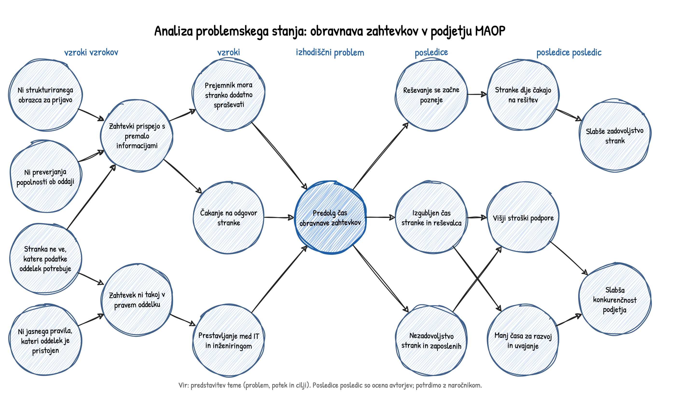

# Analiza problemskega stanja

Slika analize problemskega stanja za problem podjetja MAOP: vzroki in posledice predolgega časa
obravnave zunanjih zahtevkov (zahtevek odda stranka).

Datoteke:

- [`analiza-problemskega-stanja.drawio`](analiza-problemskega-stanja.drawio): izvorna slika;
  odpri v <https://app.diagrams.net/> (File → Open from → Device). Narisana je v ročnem slogu
  (sketch) s pisavo Patrick Hand.
- [`analiza-problemskega-stanja.png`](analiza-problemskega-stanja.png): slika za Word. Po
  spremembi jo ponovno izvozi v diagrams.net: File → Export as → PNG (zoom 200 %).
- [`prejšnja verzija/`](<prejšnja verzija/>): prva, čista verzija (SVG, PNG in skripta
  `generiraj.py`, ki ustvari SVG: `python3 generiraj.py analiza-problemskega-stanja.svg`).

Usmeritve: `docs/analiza_problemskega_stanja.pdf`. Uporabljena sta samo krog in ravna puščica;
izhodiščni problem je v sredini, vzroki in vzroki vzrokov levo, posledice in posledice posledic
desno; vsi krogi so enako veliki, puščice tečejo od leve proti desni.

## Izhodiščni problem

**Predolg čas obravnave zahtevkov.** Razlika med obstoječim stanjem (zahtevki prispejo nepopolni,
sledi dodatno spraševanje in čakanje) in želenim stanjem (zahtevek je ob oddaji popoln in takoj v
pravem oddelku).

## Vzroki

| Vzrok vzroka | Vzrok | Neposredni vzrok problema |
|---|---|---|
| Ni strukturiranega obrazca za prijavo; ni preverjanja popolnosti ob oddaji; stranka ne ve, katere podatke oddelek potrebuje | Zahtevki prispejo s premalo informacijami | Prejemnik mora stranko dodatno spraševati; čakanje na odgovor stranke |
| Stranka ne ve, katere podatke oddelek potrebuje; ni jasnega pravila, kateri oddelek je pristojen | Zahtevek ni takoj v pravem oddelku | Prestavljanje med IT in inženiringom |

## Posledice

| Posledica | Posledica posledice |
|---|---|
| Reševanje se začne pozneje | Stranke dlje čakajo na rešitev → slabše zadovoljstvo strank |
| Izgubljen čas stranke in reševalca | Višji stroški podpore; manj časa za razvoj in uvajanje → slabša konkurenčnost podjetja |
| Nezadovoljstvo strank in zaposlenih | Višji stroški podpore |

Vzroki in neposredne posledice izhajajo iz predstavitve teme (problem, potek v petih korakih,
cilji). Posledice posledic (stranke, stroški, konkurenčnost) so ocena avtorjev in jih potrdimo z
naročnikom.

Povezana slika: [obogatena slika problema](<../obogatena slika/README.md>).
