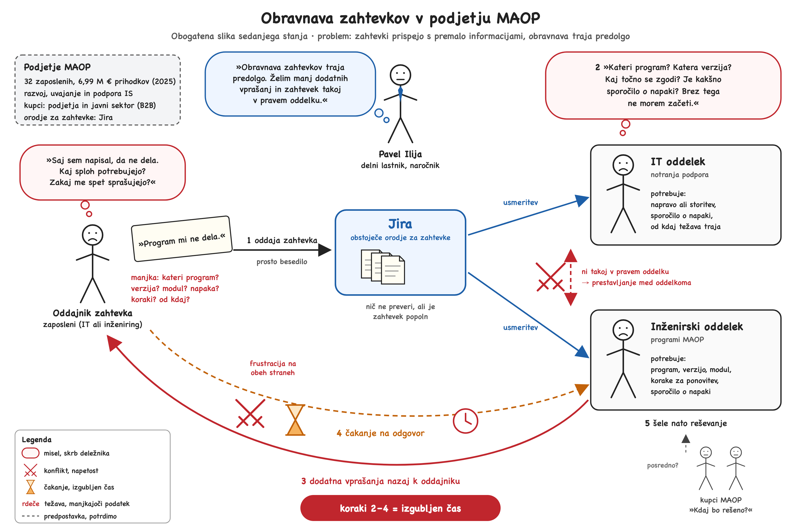

# Obogatena slika problema

Poglavje 2.2 seminarske naloge: obogatena slika (rich picture) obravnave zahtevkov v podjetju MAOP.

Datoteke:

- [`obogatena-slika.svg`](obogatena-slika.svg): izvorna slika (vektorska, urejanje v brskalniku, Inkscape ali Visio)
- [`obogatena-slika.png`](obogatena-slika.png): slika za vstavljanje v Word (3200 × 2120 px)

Usmeritve: V. Pham, *Rich Pictures and CATWOE: Simple yet Powerful Scope-Modelling Techniques*,
Elabor8, 11. 8. 2014,
<https://www.elabor8.com.au/rich-pictures-and-catwoe-simple-yet-powerful-scope-modelling-techniques/>
(pregledano 27. 11. 2026). Obogatena slika nima predpisane notacije. Prikazuje sistem v širšem
smislu: ljudi, njihove odnose, skrbi in napetosti, ne le informacijski sistem. Prikazuje sedanje
stanje (AS-IS), ne rešitve. Članek jo dopolnjuje z vprašanji CATWOE (spodaj).

## Kaj slika prikazuje

Sedanji potek obravnave zahtevka, oštevilčen kot v predstavitvi teme:

1. **Oddaja zahtevka.** Oddajnik (zaposleni) napiše zahtevek v prostem besedilu, npr.
   »Program mi ne dela.«, brez programa, verzije, modula, sporočila o napaki in korakov.
2. **Prejemnik ugotovi, da manjka podatek.** Jira zahtevek sprejme, ne da bi preverila, ali je
   popoln. Reševalec v IT ali inženirskem oddelku brez manjkajočih podatkov ne more začeti.
3. **Dodatna vprašanja** gredo nazaj k oddajniku.
4. **Čakanje na odgovor.**
5. **Šele nato reševanje.** Koraki 2–4 so izgubljen čas.

Deležniki in njihove skrbi (oblački misli):

| Deležnik | Skrb |
|---|---|
| Pavel Ilija, delni lastnik (naročnik) | obravnava traja predolgo; želi manj dodatnih vprašanj in zahtevek takoj v pravem oddelku |
| Oddajnik zahtevka (zaposleni) | ne ve, katere podatke oddelek potrebuje; dodatna vprašanja ga motijo |
| Reševalec v IT oddelku | potrebuje napravo ali storitev, sporočilo o napaki, od kdaj težava traja |
| Reševalec v inženirskem oddelku | potrebuje program, verzijo, modul, korake za ponovitev, sporočilo o napaki |
| Kupci MAOP (podjetja, javni sektor) | posredno: dlje čakajo na rešitev (predpostavka) |

Napetosti (prekrižana meča):

- med oddajnikom in reševalcem: dodatna vprašanja in čakanje povzročata frustracijo na obeh
  straneh;
- med IT in inženirskim oddelkom: zahtevek ni vedno takoj v pravem oddelku in ga je treba
  prestaviti.

## CATWOE

| | Vprašanje | MAOP |
|---|---|---|
| **C** Client (odjemalec) | Kdo ima korist ali škodo? | Oddajniki zahtevkov (zaposleni) in posredno kupci MAOP. Zdaj čakajo in odgovarjajo na dodatna vprašanja; z rešitvijo vprašanja dobijo že ob oddaji. |
| **A** Actors (izvajalci) | Kdo izvaja proces? | Oddajniki, ki izpolnijo obrazec, in reševalci v IT in inženirskem oddelku, ki zahtevke rešujejo v Jiri. |
| **T** Transformation (preoblikovanje) | Kaj se iz česa naredi? | Vhod: potreba oz. težava zaposlenega. Izhod: popoln zahtevek v pravem oddelku, ki ga je mogoče takoj reševati. |
| **W** World view (pogled na svet) | Zakaj je to pomembno? | Če zahtevek ob oddaji vsebuje vse potrebne podatke, odpadejo koraki 2–4 in obravnava je krajša. |
| **O** Owner (lastnik) | Kdo lahko spremembo podpre ali ustavi? | Pavel Ilija, delni lastnik MAOP. |
| **E** Environment (okolje) | Katere omejitve veljajo? | Obstoječa Jira ostane (zaposleni delajo v istem sistemu); 32 zaposlenih; vsebina zahtevkov je interna (za AI preverjanje potrebujemo soglasje naročnika); stroški in omejitve brezplačnih storitev. |

**Korenska definicija (root definition):** sistem, ki ga ima v lasti vodstvo MAOP in v katerem
zaposleni pri oddaji zahtevka že dobijo vprašanja o manjkajočih podatkih, da zahtevek v obstoječi
Jiri pride popoln in v pravi oddelek, s čimer se skrajša čas obravnave, ob omejitvi, da zaposleni
še naprej delajo v obstoječem sistemu.

## Kaj še potrdimo z naročnikom

Črtkano na sliki je predpostavka. Pred oddajo naloge potrdimo:

- ali na zahtevke posredno čakajo tudi kupci (inženirski zahtevki o programih MAOP);
- kako pogosto zahtevek pride v napačen oddelek;
- po kateri poti gredo dodatna vprašanja (Jira komentar, e-pošta, telefon) in koliko časa običajno
  traja odgovor.
